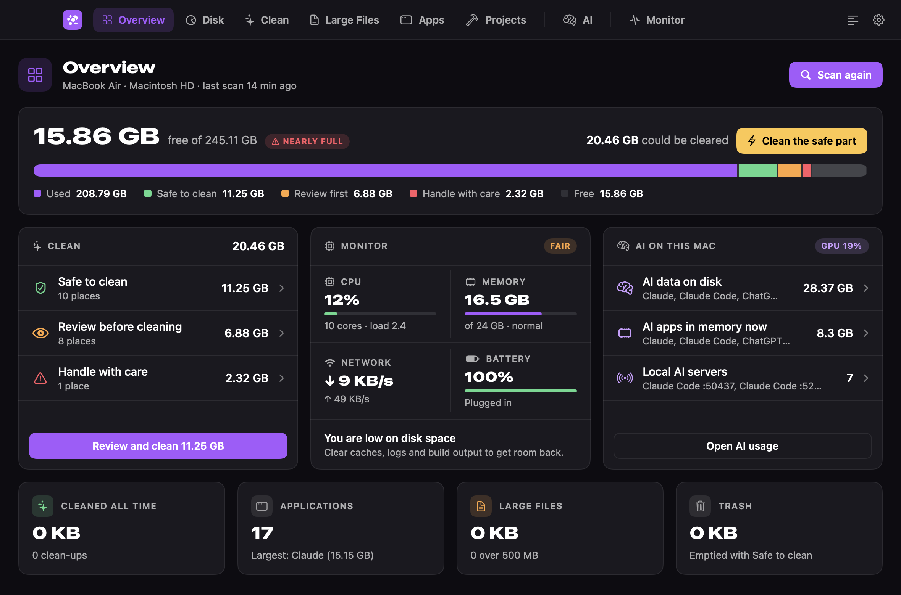
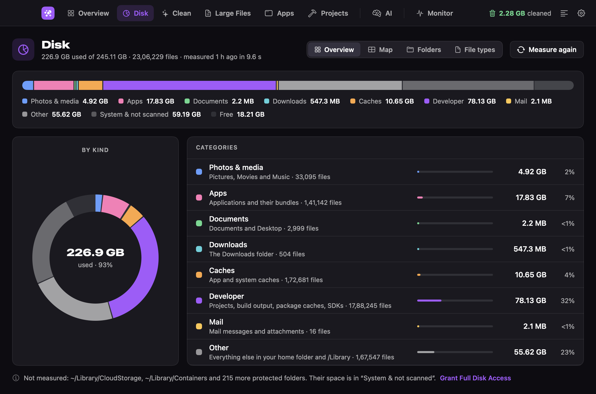
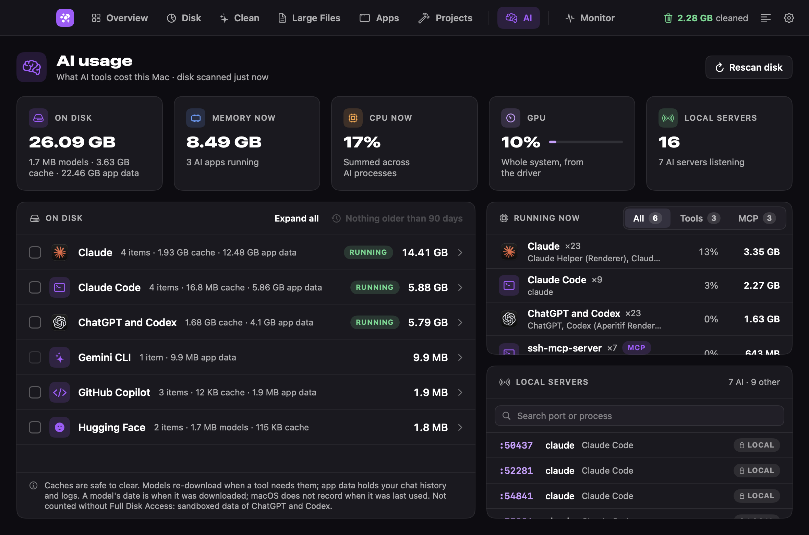
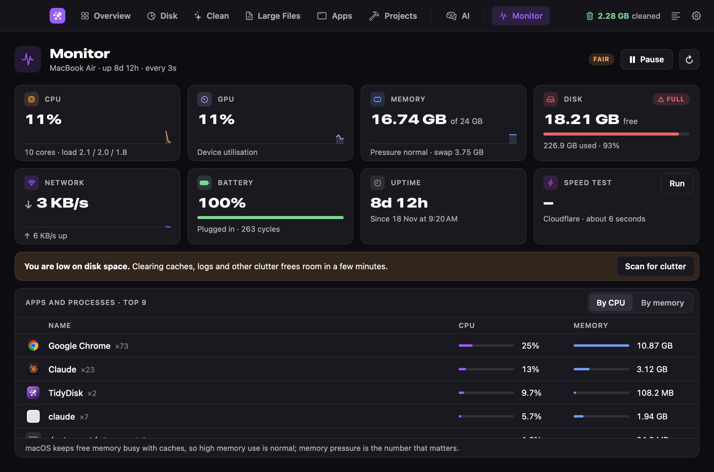
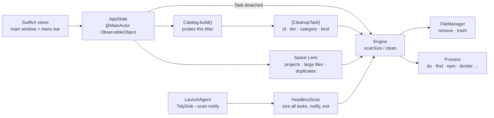

# 🫧 TidyDisk

[](https://github.com/prateekcode/tidydisk/releases/latest)
[](https://github.com/prateekcode/tidydisk/actions/workflows/build.yml)
[](LICENSE)
[](#install)
[](Package.swift)
[](https://github.com/prateekcode/homebrew-tap)
[](https://github.com/prateekcode/tidydisk/stargazers)

**Free disk cleaner for Mac developers.** Reclaims the gigabytes hiding in Xcode DerivedData, node_modules, simulators, package-manager caches and forgotten projects — safely, with everything reviewed before it's touched.

**Website & download:** [tidydisk.riekapps.com](https://tidydisk.riekapps.com)



- Runs on your Mac: no account, no ads. It sends nothing unless you switch on anonymous usage statistics in Settings, which are off by default ([Privacy](#privacy))
- Native SwiftUI, universal binary (Apple Silicon + Intel), a few MB on disk
- Notarized by Apple
- Open source under the MIT license, and [open to contributions](#contributing)

## Why it exists

A developer Mac fills up in places Finder doesn't show you: Xcode DerivedData and device-support folders, simulator runtimes, `~/.gradle`, npm/pnpm/yarn stores, Docker images, and a `node_modules` in every project you ever cloned. General-purpose cleaners don't know these locations, and cleaning them by hand means remembering which ones are safe to wipe and which ones will cost you an hour of rebuilding.

TidyDisk is for iOS, Android, Flutter, web and backend developers who want that space back without writing (or trusting) a one-off shell script.

### Why not just a shell script, or a general cleaner?

A script works, and TidyDisk's catalog started as one. But a script removes what it was written for, on the Mac it was written on, and it does not show you sizes first. TidyDisk measures before it touches anything, offers only the tools that are installed on this Mac, sorts every cleaner into a risk group, and logs each action.

A general-purpose cleaner covers the whole system, but developer folders are rarely its focus. TidyDisk does the opposite: it is narrow, free, and every cleaner is a few readable lines in [one file](Sources/TidyDisk/Models/Catalog.swift), so you can check exactly what will be removed before you trust it, or add the one that is missing.

## Install

**Homebrew:**

```sh
brew install --cask prateekcode/tap/tidydisk
```

**Or manually:** download the zip from [tidydisk.riekapps.com](https://tidydisk.riekapps.com), unzip, drag `TidyDisk.app` to Applications.

Requires macOS 14 (Sonoma) or later.

## What it does

TidyDisk probes your Mac at launch and only shows what is actually there:

- **Overview**: free space, what can be cleared in three risk groups, live CPU, memory, network and battery
- **Disk**: where the space went, by location, as a treemap, by folder and by file type (one pass over about 2 million files takes around 8 seconds)
- **Clean**: Xcode DerivedData and caches, CocoaPods, npm/pnpm/yarn, Gradle, Homebrew, SwiftPM, Docker, simulator runtimes, old device-support folders, app caches, Trash and more
- **Large Files**: everything over a size you pick, moved to Trash when you say so
- **Apps**: installed apps with the files they keep in `~/Library`, uninstall to Trash, and leftovers of apps you already removed
- **Projects**: finds every dev project on your Mac (via `.git`, `package.json`, `pubspec.yaml`, `*.xcodeproj`, …) and cleans their build artifacts (`node_modules`, `build`, `.dart_tool`, `Pods`, `.gradle`); can also push a project to a private GitHub repo or archive it to iCloud before you delete it
- **AI**: what Claude, ChatGPT, Ollama, LM Studio, Cursor and other AI tools cost in disk, memory and CPU, with their MCP servers and local ports
- **Monitor**: CPU, GPU, memory, disk, network, battery, top processes and a speed test
- **Duplicates**: identical files in Downloads and Desktop, newest copy kept
- **Menu bar**: free space at a glance (updates by itself), one-click scan, optional weekly scan with a notification

**Disk**: where the space went, by location, map, folder and file type.



**AI**: what local models, caches and chat data of AI tools take, and what is running now.



**Monitor**: live system readings and the heaviest processes.



## Safety model

Three risk groups keep it safe: **Safe to clean** is one button away, **Review before cleaning** and **Handle with care** (e.g. all node_modules) always need an explicit opt-in.

What that means in practice, as implemented:

| | Behaviour |
|:--|:--|
| **Scanning is read-only** | A scan only measures sizes. Nothing is removed until you press Clean. |
| **Probe before offering** | The task catalog is built per Mac: a task appears only if its directory, app or CLI tool exists. |
| **Nothing is ticked for you** | After a scan every box is empty; one button ticks the safe group. The other two groups are never selected for you, and cleaning them asks once more. |
| **Caches are deleted, files are trashed** | Cache and build-artifact cleanup deletes permanently, because those folders are regenerated by the tools that own them. **Large Files**, **Duplicates**, **Apps** (uninstall and leftovers) and **AI** move items to the Trash, so they're recoverable. |
| **Tool-aware commands** | Package-manager tasks call the tool's own command (`npm cache clean`, `pnpm store prune`, …) and are skipped if the tool isn't installed; Docker tasks are skipped if the daemon isn't running. |
| **Guard rails** | Project sweeps never touch the global `~/.gradle`; "all but newest" tasks (e.g. Android NDKs) always keep the newest version. |
| **Every action is logged** | Each cleanup writes `[done]` / `[skip]` / `[fail]` lines you can review in the app. |

TidyDisk can't know whether *you* still need something. Review the selection before cleaning, and keep backups of anything irreplaceable.

## How it works



- **`Models/CleanupTask.swift`** — a task is data: a `RiskTier`, a `TaskCategory` and a `TaskKind` describing *how* to clean (`directoryContents`, `findAndRemove`, `commands`, `allButNewest`, `projectSweep`, `appCacheSweep`).
- **`Models/Catalog.swift`** — builds the task list for the current machine, adding a task only when its target exists.
- **`Engine/Engine.swift`** — one `switch` over `TaskKind` for sizing and one for cleaning. Sizing shells out to `du -sk`; directory discovery uses a pruned `find`.
- **`Engine/DiskWalker.swift`** — the Disk tab's index: one parallel `getattrlistbulk` pass that sorts every file by location and type, stays on one volume, and skips folders macOS protects unless Full Disk Access is granted.
- **`Engine/AppScanner.swift`, `Engine/AICatalog.swift`, `Engine/SystemProbe.swift`** — the Apps, AI and Monitor tabs: apps with their `~/Library` files, a data-driven catalog of AI tools, and live system readings.
- **`Stores/`** — one `ObservableObject` per tab (`DiskStore`, `AppsStore`, `AIStore`, `MonitorStore`), owned by `AppState`.
- **`UI/Theme.swift`, `UI/Components/Components.swift`** — every colour and every shared view; screens do not draw their own cards.
- **`Engine/SpaceLens.swift`** — discovers project roots (markers like `.git`, `package.json`, `pubspec.yaml`, `go.mod`, `Cargo.toml`, `*.xcodeproj`, up to 4 levels below home, keeping only top-most roots).
- **`Engine/Duplicates.swift`** — groups candidates by size first, then by MD5, and keeps the newest copy.
- **`Engine/ProjectActions.swift`, `Engine/GitHubAuth.swift`** — archive a project to iCloud/cloud storage, or push it to a private GitHub repo (token kept in the macOS Keychain, with `gh` CLI fallback).
- **`Engine/ScheduledScan.swift`** — installs/removes the weekly LaunchAgent that runs the binary headless with `--scan-notify`.
- **`AppState.swift`** — UI state on the main actor; scans and cleanups run in detached tasks so the UI stays responsive.

## Design decisions

- **Cleaners shell out to `du` and `find`**: they're fast, battle-tested, and handle huge trees well. The trade-off is a dependency on system tools and synchronous `Process` calls, which is why every call runs off the main actor.
- **The Disk tab walks the disk itself** with `getattrlistbulk`, because it needs every file's size, type and location in one pass (about 2 million files in around 8 seconds).
- **Tasks as data, not code paths.** New cleanups are a `CleanupTask` entry in the catalog; the engine stays one small `switch` per operation.
- **Use each tool's own cleanup command** where one exists (npm, pnpm, yarn, Docker) rather than deleting its internals directly.
- **Pure SwiftPM, no Xcode project.** `build.sh` assembles the `.app` bundle, so the repo stays small and builds from the command line.
- **Menu bar + headless mode** share the same engine, so the weekly scan reports exactly what the app would show.

## Build from source

Pure SwiftPM — no Xcode project needed:

```sh
./build.sh            # build + ad-hoc sign TidyDisk.app
./build.sh --install  # also copy to /Applications
```

The task catalog lives in `Sources/TidyDisk/Models/Catalog.swift` — add a `CleanupTask` there to extend the app. [CONTRIBUTING.md](CONTRIBUTING.md) walks through it.

## Testing

There's no automated test suite yet. To check a change:

1. `./build.sh` and open `TidyDisk.app`.
2. Run a scan — scanning is read-only, so it's safe to compare reported sizes against `du -sh <path>`.
3. Try a new or changed task on a throwaway directory before running it on real data, and read the cleanup log.
4. `TidyDisk --shot <tab> out.png` renders a tab to an image and exits; `TidyDisk --measure [folder]` prints the disk breakdown.

## Notes

- Emptying Trash and reading some app containers needs **Full Disk Access** (System Settings → Privacy & Security). Without it those items report 0 and are skipped.
- The weekly scan is a LaunchAgent running `TidyDisk --scan-notify` headless; its plist points at the app's executable, so re-toggle it if you move the app.
- Network access is only used for features you start yourself, such as pushing a project to GitHub, and for the anonymous usage statistics if you switch them on.

## Privacy

TidyDisk has no account and no ads. It sends nothing unless you switch on anonymous usage statistics in Settings, and they are off by default.

- Scanning, measuring and cleaning happen on your Mac.
- If you switch statistics on, they are anonymous and limited to how the app is used. They never include file names, paths or folder names. The code that sends them is in [`UsageStats.swift`](Sources/TidyDisk/Engine/UsageStats.swift), so you can read exactly what is included.
- The only other network traffic comes from features you start yourself, such as pushing a project to GitHub or running the speed test.

## Contributing

Contributions are welcome, and most of them are small: a cache TidyDisk does not know yet, an AI tool that is missing, a size that is wrong.

- [CONTRIBUTING.md](CONTRIBUTING.md) explains how to build the app, add a cleaner or an AI tool, and check a UI change. It also lists good first issues.
- Know a tool or folder TidyDisk should clean? Fill in the [cleaner request form](https://github.com/prateekcode/tidydisk/issues/new?template=cleaner_request.yml). Paths and a typical size are enough.
- Questions and ideas go to [Discussions](https://github.com/prateekcode/tidydisk/discussions); bugs to the [bug report form](https://github.com/prateekcode/tidydisk/issues/new?template=bug_report.yml).
- Found something that could delete or expose files it should not? See [SECURITY.md](SECURITY.md) and report it privately.

Changes between versions are in [CHANGELOG.md](CHANGELOG.md). Everyone taking part is expected to follow the [code of conduct](CODE_OF_CONDUCT.md).

## Links

- Website & download: [tidydisk.riekapps.com](https://tidydisk.riekapps.com)
- On RiekApps: [riekapps.com/app/tidydisk](https://riekapps.com/app/tidydisk)
- Guide: [Free up disk space on Mac](https://riekapps.com/blog/free-up-disk-space-on-mac)
- Homebrew tap: [prateekcode/homebrew-tap](https://github.com/prateekcode/homebrew-tap)

## License

[MIT](LICENSE) © RiekApps
