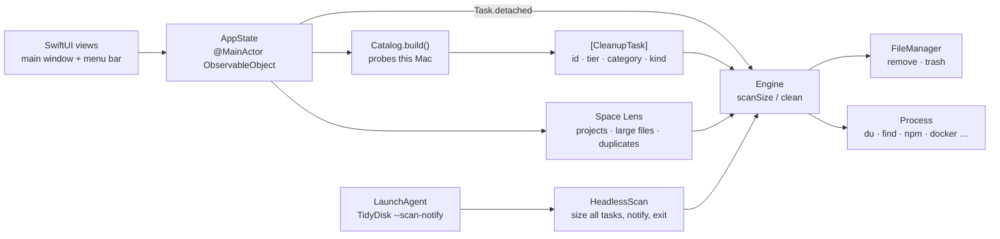

# 🫧 TidyDisk

**Free disk cleaner for Mac developers.** Reclaims the gigabytes hiding in Xcode DerivedData, node_modules, simulators, package-manager caches and forgotten projects — safely, with everything reviewed before it's touched.

**Website & download:** [tidydisk.riekapps.com](https://tidydisk.riekapps.com)


- 100% on-device — no account, no telemetry; scanning and cleaning never leave your Mac
- Native SwiftUI, universal binary (Apple Silicon + Intel), a few MB on disk
- Notarized by Apple

## Why it exists

A developer Mac fills up in places Finder doesn't show you: Xcode DerivedData and device-support folders, simulator runtimes, `~/.gradle`, npm/pnpm/yarn stores, Docker images, and a `node_modules` in every project you ever cloned. General-purpose cleaners don't know these locations, and cleaning them by hand means remembering which ones are safe to wipe and which ones will cost you an hour of rebuilding.

TidyDisk is for iOS, Android, Flutter, web and backend developers who want that space back without writing (or trusting) a one-off shell script.

## Install

**Homebrew:**

```sh
brew install --cask prateekcode/tap/tidydisk
```

**Or manually:** download the zip from [tidydisk.riekapps.com](https://tidydisk.riekapps.com), unzip, drag `TidyDisk.app` to Applications.

Requires macOS 14 (Sonoma) or later.

## What it cleans

TidyDisk probes your Mac at launch and only shows what's actually there:

- **Smart Scan** — Xcode DerivedData & caches, CocoaPods, npm/pnpm/yarn, Gradle, Homebrew, SwiftPM, Docker, simulator runtimes, old device-support folders, app caches, Trash, and more
- **Space Lens → Projects** — finds every dev project on your Mac (via `.git`, `package.json`, `pubspec.yaml`, `*.xcodeproj`, …) and cleans their build artifacts (`node_modules`, `build`, `.dart_tool`, `Pods`, `.gradle`); can also push a project to a private GitHub repo or archive it to iCloud before you delete it
- **Large Files** — everything over 200 MB in your home folder
- **Duplicates** — identical files in Downloads & Desktop, newest copy kept
- **Menu bar** — free space at a glance, one-click scan, optional weekly scan with a notification

## Safety model

Three risk tiers keep it safe: **safe** caches are pre-selected, **aggressive** and **nuclear** (e.g. all node_modules) always need an explicit opt-in.

What that means in practice, as implemented:

| | Behaviour |
|:--|:--|
| **Scanning is read-only** | A scan only measures sizes (`du`, `find`). Nothing is removed until you press Clean. |
| **Probe before offering** | The task catalog is built per Mac: a task appears only if its directory, app or CLI tool exists. |
| **Safe tier pre-selected** | Only safe tasks with something to reclaim start ticked. Aggressive and nuclear tasks are never selected for you. |
| **Caches are deleted, files are trashed** | Cache and build-artifact cleanup deletes permanently, because those folders are regenerated by the tools that own them. **Large Files** and **Duplicates** move items to the Trash, so they're recoverable. |
| **Tool-aware commands** | Package-manager tasks call the tool's own command (`npm cache clean`, `pnpm store prune`, …) and are skipped if the tool isn't installed; Docker tasks are skipped if the daemon isn't running. |
| **Guard rails** | Project sweeps never touch the global `~/.gradle`; "all but newest" tasks (e.g. Android NDKs) always keep the newest version. |
| **Every action is logged** | Each cleanup writes `[done]` / `[skip]` / `[fail]` lines you can review in the app. |

TidyDisk can't know whether *you* still need something. Review the selection before cleaning, and keep backups of anything irreplaceable.

## How it works



- **`Models/CleanupTask.swift`** — a task is data: a `RiskTier`, a `TaskCategory` and a `TaskKind` describing *how* to clean (`directoryContents`, `findAndRemove`, `commands`, `allButNewest`, `projectSweep`, `appCacheSweep`).
- **`Models/Catalog.swift`** — builds the task list for the current machine, adding a task only when its target exists.
- **`Engine/Engine.swift`** — one `switch` over `TaskKind` for sizing and one for cleaning. Sizing shells out to `du -sk`; directory discovery uses a pruned `find`.
- **`Engine/SpaceLens.swift`** — discovers project roots (markers like `.git`, `package.json`, `pubspec.yaml`, `go.mod`, `Cargo.toml`, `*.xcodeproj`, up to 4 levels below home, keeping only top-most roots) and finds large files.
- **`Engine/Duplicates.swift`** — groups candidates by size first, then by MD5, and keeps the newest copy.
- **`Engine/ProjectActions.swift`, `Engine/GitHubAuth.swift`** — archive a project to iCloud/cloud storage, or push it to a private GitHub repo (token kept in the macOS Keychain, with `gh` CLI fallback).
- **`Engine/ScheduledScan.swift`** — installs/removes the weekly LaunchAgent that runs the binary headless with `--scan-notify`.
- **`AppState.swift`** — UI state on the main actor; scans and cleanups run in detached tasks so the UI stays responsive.

## Design decisions

- **Shell out to `du` and `find`** instead of walking directories in Swift: they're fast, battle-tested, and handle huge trees well. The trade-off is a dependency on system tools and synchronous `Process` calls, which is why every call runs off the main actor.
- **Tasks as data, not code paths.** New cleanups are a `CleanupTask` entry in the catalog; the engine stays one small `switch` per operation.
- **Use each tool's own cleanup command** where one exists (npm, pnpm, yarn, Docker) rather than deleting its internals directly.
- **Pure SwiftPM, no Xcode project.** `build.sh` assembles the `.app` bundle, so the repo stays small and builds from the command line.
- **Menu bar + headless mode** share the same engine, so the weekly scan reports exactly what the app would show.

## Build from source

Pure SwiftPM — no Xcode project needed:

```sh
./build.sh            # build + ad-hoc sign TidyDisk.app
./build.sh --install  # also copy to /Applications
```

The task catalog lives in `Sources/TidyDisk/Models/Catalog.swift` — add a `CleanupTask` there to extend the app.

## Testing

There's no automated test suite yet. To check a change:

1. `./build.sh` and open `TidyDisk.app`.
2. Run a **Smart Scan** — scanning is read-only, so it's safe to compare reported sizes against `du -sh <path>`.
3. Try a new or changed task on a throwaway directory before running it on real data, and read the cleanup log.

## Notes

- Emptying Trash and reading some app containers needs **Full Disk Access** (System Settings → Privacy & Security). Without it those items report 0 and are skipped.
- The weekly scan is a LaunchAgent running `TidyDisk --scan-notify` headless; its plist points at the app's executable, so re-toggle it if you move the app.
- Network access is only used for features you start yourself, such as pushing a project to GitHub.

## Links

- Website & download: [tidydisk.riekapps.com](https://tidydisk.riekapps.com)
- On RiekApps: [riekapps.com/app/tidydisk](https://riekapps.com/app/tidydisk)
- Guide: [Free up disk space on Mac](https://riekapps.com/blog/free-up-disk-space-on-mac)
- Homebrew tap: [prateekcode/homebrew-tap](https://github.com/prateekcode/homebrew-tap)

## License

[MIT](LICENSE) © RiekApps
